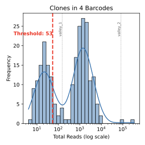
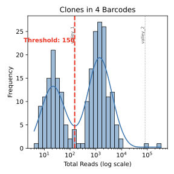

# Cellecta DriverMap AIR V2 — VBC Analysis

This pipeline uses validator barcodes (VBCs) to filter low-support clonotypes
and estimate template molecules from MiXCR clone tables. It operates on one
sample directory at a time.

## 1. Complete VBC Pipeline

Use the combined runner for the normal workflow. It performs barcode
hopping/VBC filtering first, then template-molecule quantification.

```bash
bash run_vbc_pipeline.sh DIRECTORY SAMPLE_NAME --mode MODE --filter-selection FILTER_SELECTION
```

For example:

```bash
bash run_vbc_pipeline.sh ~/Desktop/test_T/ test_T \
  --mode bulk \
  --filter-selection by_prominence
```

### Inputs

| Input | Description |
| --- | --- |
| `DIRECTORY` | Sample MiXCR-output directory containing the relevant clone table(s). |
| `SAMPLE_NAME` | MiXCR output prefix for that sample. |
| `--mode MODE` | `bulk` or `single_cell` (default: `bulk`). |
| `--filter-selection FILTER_SELECTION` | `by_distance`, `by_prominence`, or `manual` (default: `by_distance`). |

### Outputs

| File | Purpose |
| --- | --- |
| `SAMPLE.histograms.pdf` | Histograms, KDE curves, candidate valleys, and the selected VBC thresholds. Review this file for every sample. |
| `SAMPLE.kde.maximas.txt` | KDE threshold and peak values used by filtering and template estimation. |
| `SAMPLE.vbcFiltering.report.txt` | Filtering row/read-count summary. |
| `SAMPLE.vbc_analysis.manifest.json` | Machine-readable run metadata, including mode, filter-selection strategy, thresholds, and candidate valleys. |
| `peak_manual_select.csv` | Optional eight-row worksheet created after an automatic filtering run; edit it only when a manual filter rerun is needed. |
| `SAMPLE.templateEstimation.report.txt` | Template-estimation summary, including the normalization factor and clonotypes removed during template estimation. |
| `SAMPLE.clones_CHAIN.quantified.tsv` | Quantified clonotype table for each detected chain, for example `SAMPLE.clones_TRA.quantified.tsv` and `SAMPLE.clones_TRB.quantified.tsv`. |

Note: `SAMPLE.clones_ALL.quantified.tsv` is the combined quantified table. It
is normally split into the chain-specific quantified tables above and removed.
It remains in the sample directory when the clone table does not contain a
`chain` column.

## 2. Barcode Hopping and VBC Filtering

Run this step alone when you want to inspect or adjust filtering before
quantification:

```bash
python3 1_vbc_filtering/run_filter_vbc.py DIRECTORY SAMPLE_NAME \
  --mode MODE \
  --filter-selection FILTER_SELECTION
```

For example, the original behavior is:

```bash
python3 1_vbc_filtering/run_filter_vbc.py ~/Desktop/test_T/ test_T \
  --mode bulk \
  --filter-selection by_distance
```

For quantification alone, after a successful filtering run:

```bash
python3 2_quantify/run_quantify.py DIRECTORY SAMPLE_NAME --mode MODE
```

Add `--force` only when you intentionally need to recreate template estimates
despite an existing template-estimation report.

### Filter-selection options

`by_distance` is the original strategy. When more than two KDE peaks are
identified, it chooses the candidate peak pair by their separation.

`by_prominence` considers the local prominence and constituent support of
adjacent KDE peak pairs. It is intended to avoid selecting a sparse far-right
tail simply because it gives a favorable position-based split.

`manual` is an optional rerun mode described in the next section. It requires
a completed automatic VBC analysis and its `peak_manual_select.csv` worksheet.

### Review the histogram PDF

Always inspect `SAMPLE.histograms.pdf` before accepting an automatic filter.
Each panel is a VBC bin: “Clones in 1 Barcodes” contains clonotypes observed
with one VBC constituent, “Clones in 2 Barcodes” contains those with two, and
so on. The x-axis is total reads on a log scale and the y-axis is the number of
clonotypes.

- Blue bars show the read-count distribution and the blue line is its KDE.
- Gray dotted lines are all detected local minima, labelled from left to right
  as `valley_1`, `valley_2`, and so forth.
- The red dashed line is the active filtering threshold. Clonotypes at or to
  the right of it are retained; those to its left are removed.

A useful threshold is generally a valley that separates low-read/background
clonotypes from the substantive higher-read distribution. A red line far into
a sparse tail, or one that cuts through a substantive mode, merits manual
review.

## 3. Manual Filter Selection

Use manual filter selection when the automatic threshold shown in the
histogram PDF is not appropriate. Manual mode keeps the same KDE and peak
analysis from the original run, but lets you explicitly select a labelled
valley as the final filter for each VBC bin. It does not apply another round of
post-selection threshold adjustments.

1. Run filtering once with `by_distance` or `by_prominence`; this also creates
   the optional `peak_manual_select.csv` worksheet. Review the histogram PDF.
2. Edit `peak_manual_select.csv` in that sample directory. It contains VBC
   bins 1–8 and accepts `keep` or a labelled valley such as `valley_2` in the
   `filter_choice` column. `keep` preserves the exact threshold from the
   original automatic run.
3. Rerun the complete workflow with `manual`:

   ```bash
   bash run_vbc_pipeline.sh DIRECTORY SAMPLE_NAME --mode MODE --filter-selection manual
   ```

   Alternatively, run filtering and quantification individually using the
   commands in the previous section.

For `single_cell` mode, only VBC bins 1–4 are active. Rows 5–8 remain in the
worksheet for consistency and are reported as ignored. If every active row is
`keep`, manual mode exits without changing any files.

Before writing new manual results, the pipeline moves the completed automatic
filtering outputs into `original_vbc_analysis/` within the sample directory.
The new manual outputs are then written at the sample-directory level. This
preserves the original histogram, thresholds, report, manifest, and filtered
table for comparison.

The example below is tcr_seq_sample_A, VBC bin 4. The original automatic
threshold (`53`) is too far left, whereas the intended filter is the labelled
valley at `150`. The manual worksheet changes that row to `valley_1`.

| Incorrect automatic selection | Correct post-manual selection |
| --- | --- |
|  |  |

In both panels, the red dashed line is the active threshold and the gray
dotted lines are the available `valley_N` choices.
